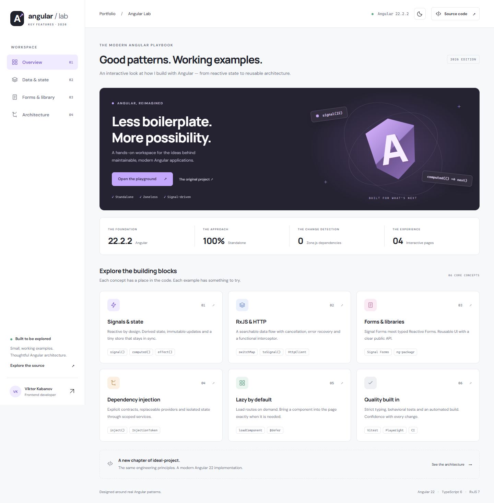

# Key-features-Angular-2026

**Good patterns. Working examples.** An interactive Angular 22 portfolio by Viktor Kabanov.

[Live demo](https://viktorgit.github.io/Key-features-Angular-2026/) · [Build & tests](https://github.com/viktorgit/Key-features-Angular-2026/actions) · [По-русски](README.ru.md)



## Explore

| Page            | Try it                                                       | Find the implementation                                                           |
| --------------- | ------------------------------------------------------------ | --------------------------------------------------------------------------------- |
| Overview        | Explore six core concepts; switch themes                     | [overview](src/app/features/overview), [theme store](src/app/core/theme.store.ts) |
| Data & state    | Search, filter, save favorites, simulate an error and retry  | [data feature](src/app/features/data)                                             |
| Forms & library | Validate and preview a request; compare typed Reactive Forms | [forms page](src/app/features/forms), [feature-ui library](projects/feature-ui)   |
| Architecture    | Increment isolated widgets; load a deferred component        | [architecture feature](src/app/features/architecture)                             |

## Run locally

Use **Node 24.19.0** (see `.nvmrc`) and npm. Angular's supported Node range is declared in `package.json`.

```sh
npm ci
npm start
```

Open [localhost:4200](http://localhost:4200). The `prestart` script builds the library automatically.

When editing the library, run `npm run ng -- build feature-ui --watch` in another terminal. The application imports its compiled public API, just as it would import a published package.

## What's demonstrated

- **Standalone, zoneless, OnPush** components and lazy route boundaries.
- **Signals** for state, `computed` for derived values, `effect` for browser persistence.
- **RxJS interop** with `toObservable` / `toSignal`, debouncing, `switchMap` cancellation and recoverable errors.
- **HttpClient** with a functional interceptor and a configurable data-source injection token.
- **Dependency injection** through `inject`, root services and component-scoped stores.
- **Signal Forms** with a validation schema, accessible feedback and a typed output.
- **Typed Reactive Forms** with non-nullable controls.
- **A real Angular library**, built with ng-packagr and consumed through `feature-ui`.
- **Control flow**: `@if`, `@for` with stable tracking, `@switch` and `@defer` with placeholder / loading / error states.
- **Theming** with shared CSS tokens and persistent light/dark preferences.
- **Tests and CI**: Vitest, Playwright, axe accessibility checks and GitHub Pages deployment.

See [architecture decisions and the Angular 13 → 22 mapping](docs/architecture.md).

## Commands

| Command               | Purpose                                                            |
| --------------------- | ------------------------------------------------------------------ |
| `npm start`           | Build the library and start the development server                 |
| `npm run build`       | Build the library and application for production                   |
| `npm run build:pages` | Build with the GitHub Pages project base URL                       |
| `npm test`            | Build the library; run app and library unit tests once             |
| `npm run test:watch`  | Watch application unit tests (build the library first)             |
| `npm run test:e2e`    | Test the **previously built Pages artifact** on desktop and mobile |
| `npm run format`      | Format source, configuration and documentation                     |
| `npm run check`       | Formatting, unit tests, Pages build and end-to-end tests           |

Before the first end-to-end run:

```sh
npx playwright install chromium
npm run build:pages
npm run test:e2e
```

To use an installed Chrome instead, set `PLAYWRIGHT_CHANNEL=chrome` (PowerShell: `$env:PLAYWRIGHT_CHANNEL='chrome'`).

`node scripts/serve-dist.mjs` previews the Pages artifact at [localhost:4173/Key-features-Angular-2026/](http://127.0.0.1:4173/Key-features-Angular-2026/).

## Deployment

The workflow builds and tests every pull request. Successful pushes to `main` also deploy to GitHub Pages. In the repository's **Settings → Pages**, the source must be **GitHub Actions**. No custom secrets are required.

The app uses hash routing so direct links and refresh work without a server rewrite:
`https://viktorgit.github.io/Key-features-Angular-2026/#/forms`.

## Deliberate boundaries

This is a frontend showcase, without authentication or a backend. The catalog is a same-origin JSON fixture; the simulated-error button creates a local error. Contact forms only preview data in memory and never send email or subscribe anyone. Theme and favorite IDs are stored locally; unavailable or corrupt storage does not break the UI.

Fonts are bundled locally. There are no analytics or external runtime APIs. The deferred chart is an illustrative model, not a performance measurement. Accessibility checks are automated coverage, not a full accessibility certification.
